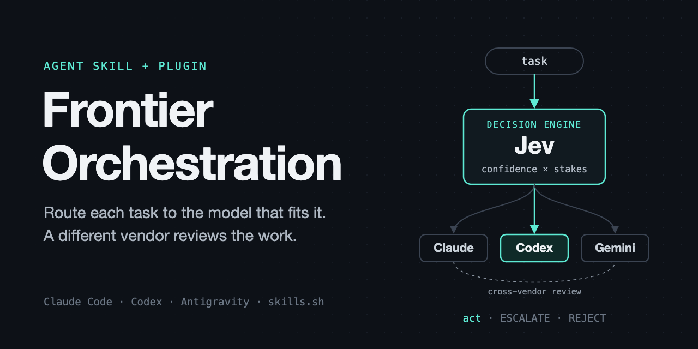
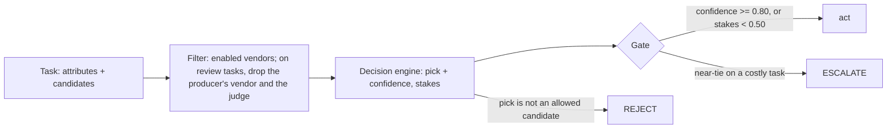

# Frontier Orchestration

Route high-stakes work across Claude, Codex and Gemini: a decision engine picks the model for
each task, and a model from a different vendor reviews the result.

[](https://github.com/bebecap/frontier-orchestration/actions/workflows/ci.yml)
[](LICENSE)
[](docs/install.md)



| Measured | Result | Evidence |
|---|---|---|
| Labeled tasks routed below frontier tier | **12 of 20**, including all 9 low-stakes tasks | [docs/cost.md](docs/cost.md) |
| High-stakes tasks kept on frontier or top models | **8 of 9** | [docs/cost.md](docs/cost.md) |
| Routing pick accuracy, TypeSafe Jev | **1.00** (local-rules baseline: 0.60) | [docs/eval.md](docs/eval.md) |
| Time per decision, hosted engine (p50) | **about 0.2 s** | [docs/eval.md](docs/eval.md) |

Measured on 2026-11-16 with `fo.py eval all --repeat 2`. No dollar or percentage saving was
measured.

## Install

Requirements: Python 3.9 or later, on macOS or Linux. The skill uses only the Python standard
library.

> **Status.** The commands below (`npx skills add` and the plugin marketplace commands) are the
> normal way to install. The npm package is not published, so `npx frontier-orchestration` does
> not work from the npm registry.

**Claude Code** (in a session):

```
/plugin marketplace add bebecap/frontier-orchestration
/plugin install frontier-orchestration@frontier-orchestration
```

From a terminal, use `claude plugin marketplace add ...` and `claude plugin install ...` with
the same arguments. Then run `/frontier-orchestration:setup` in a session.

**Any agent that reads `SKILL.md`** ([skills.sh](https://skills.sh)):

```bash
npx skills add bebecap/frontier-orchestration --skill frontier-orchestration
```

<details>
<summary><b>OpenAI Codex</b></summary>

```bash
codex plugin marketplace add bebecap/frontier-orchestration
codex plugin add frontier-orchestration@frontier-orchestration
```
</details>

<details>
<summary><b>Antigravity (agy)</b></summary>

```bash
git clone https://github.com/bebecap/frontier-orchestration
agy plugin install ./frontier-orchestration
```
</details>

<details>
<summary><b>Manual, and the npx installer prototype</b></summary>

Clone the repository and run the command line from the clone. Or copy the folder
`skills/frontier-orchestration/` into the skills folder of your agent (for Claude Code:
`~/.claude/skills/`). The skill folder holds everything it needs.

[`npm/`](npm/README.md) holds a one-command installer prototype. It is not published, so
`npx frontier-orchestration` does not work from the npm registry. To try it from a local
tarball, see [npm/README.md](npm/README.md).
</details>

Full guide: [docs/install.md](docs/install.md).

## First run

A person runs the interactive installer. It asks for the decision engine, the providers, the
telemetry choice and the ledger folder. An agent uses `fo.py setup` with flags instead.

```bash
python3 -I skills/frontier-orchestration/scripts/fo.py install
python3 -I skills/frontier-orchestration/scripts/fo.py doctor --live
```

In this README and in [docs/](docs/README.md), `fo.py` is short for the full command
`python3 -I <skill folder>/scripts/fo.py`. From a clone, the skill folder is
`skills/frontier-orchestration`. The commands print hints with the full path on your machine.

See a route with no setup, no network and no key (engine `off`, local rules):

```
$ FO_JEV_BACKEND=off python3 -I skills/frontier-orchestration/scripts/fo.py route --demo
task              model               conf  stakes  decision
--------------------------------------------------------------
repo_sweep        sonnet               -      0.40  act
estimate_review   gpt-6-astra          -      0.85  ESCALATE
arithmetic_audit  haiku                -      0.10  act
```

In an agent session, ask for example: "Route this estimate review across vendors and tell me
which model should review it." The agent runs `fo.py route` and returns one decision per task:
`act`, `ESCALATE` or `REJECT`.

## What's inside

| Part | What it does | When to use it |
|---|---|---|
| [`SKILL.md`](skills/frontier-orchestration/SKILL.md) | the rules an agent follows: discovery, routing, the gate, review, the learning loop | loaded by the host when a task is high-stakes or spans many files |
| `fo.py route` | picks a model for each task and gates the pick | before you give tasks in a pipeline to models |
| `fo.py ask` | one read-only ask through another vendor's own CLI ([providers](docs/providers.md)) | a second opinion or an adversarial review |
| `fo.py eval` | measures a decision engine on fixed datasets | before you trust a new engine, model id or OpenJev build |
| `fo.py lessons` | a learning ledger of lessons and runs | recall before a run; record after it |
| `fo.py doctor`, `refresh` | checks config, keys and sign-in; lists the models each CLI offers today | first use, and after a CLI update |
| `/frontier-orchestration:setup` | asks the setup questions in Claude Code | first use in Claude Code |

Command list: `fo.py --help`. Every subcommand accepts `--help` and then does no work.

## How it works



The engine is a System One model ("Jev"): it returns typed answers and probabilities, not text.
Choose TypeSafe Jev (hosted), OpenJev (self-hosted, open weights), OpenJev on Codiv, any
compatible server, or `off` (local rules). Self-hosted OpenJev on a Mac needs Apple silicon and
a download of about 14 GB; plan for 24 GB of memory or more. Self-hosted OpenJev on Linux needs an
NVIDIA GPU and Docker with the NVIDIA runtime. The hosted engines (TypeSafe Jev, OpenJev on Codiv)
and `off` work on any macOS or Linux machine. Details:
[docs/how-it-works.md](docs/how-it-works.md) and [docs/install.md](docs/install.md).

## Results

| Engine | Sanity | Routing pick | Stakes | Brier | Time per request (p50) |
|---|---|---|---|---|---|
| TypeSafe Jev (hosted) | 1.000 | 1.00 | 0.889 | 0.081 | about 0.2 s |
| OpenJev, compact (mxfp4) | 1.000 | 0.85 | 0.833 | 0.107 | about 2.3 to 2.6 s sanity, 2.2 s routing |
| OpenJev, standard (4-bit) | 0.958 | 0.90 | 0.778 | 0.155 | about 0.9 s sanity, 2.3 s routing |
| `off` (local heuristic) | skipped | 0.60 | 0.778 | 0.132 | no network call |

Limits:

- The datasets are small: 24 sanity questions and 20 routing tasks. A difference of one or two
  cases is noise.
- OpenJev times change from run to run on the same machine. The standard build's times are from
  the first build comparison, where the compact build measured about 1.0 s sanity. See the run
  log in [docs/eval.md](docs/eval.md#run-log).
- The evidence counts which tier each pick went to. It does not measure a bill or the quality
  of the work done by the cheaper model. Measure both on your own workload.
- Not every engine wins: the standard OpenJev build scored 0.958 on sanity, and both OpenJev
  builds picked less accurately than TypeSafe Jev (0.85 and 0.90 against 1.00).

Method, metrics and datasets: [docs/eval.md](docs/eval.md). Cost evidence:
[docs/cost.md](docs/cost.md).

## For agents

`FO` means `python3 -I "<skill folder>/scripts/fo.py"`. In Claude Code the skill folder is
`${CLAUDE_SKILL_DIR}`.

1. `FO doctor`. If there is no config: `FO setup --non-interactive`. Exit 3 prints questions.
   Ask the user each one. Never answer for the user, above all the telemetry question.
2. `FO doctor --live`, then `FO refresh`, then `FO lessons recall --tags <kind>,<project>`.
3. `FO route --check tasks.json`, then `FO route tasks.json --json`. Act, escalate or stop.
4. `FO ask codex --prompt-file packet.md --cwd <repo>`. Only status `ok` is a verdict.
5. Record the run: `FO lessons run-new ...`, then `run-close` and `lint`.

Exit codes: 0 ok; 1 failure; 2 `route` REJECT (or an `eval` error); 3 `setup` needs answers.
Full rules: [SKILL.md](skills/frontier-orchestration/SKILL.md). Repository map: [llms.txt](llms.txt).

## Update and uninstall

| Host | Update | Uninstall |
|---|---|---|
| Claude Code | `claude plugin marketplace update frontier-orchestration`, then `claude plugin update frontier-orchestration@frontier-orchestration` | `claude plugin uninstall frontier-orchestration@frontier-orchestration` |
| Codex | `codex plugin marketplace upgrade frontier-orchestration` | `codex plugin remove frontier-orchestration@frontier-orchestration` |
| Antigravity | `git pull` in the clone, then install again | `agy plugin uninstall frontier-orchestration` |
| skills.sh | `npx skills update frontier-orchestration` | `npx skills remove frontier-orchestration` |

The skill keeps its files in `~/.config/frontier-orchestration/` (config),
`~/.local/state/frontier-orchestration/` (state, telemetry log) and
`~/.local/share/frontier-orchestration/` (ledger, OpenJev). Delete them to remove everything.

**Troubleshooting.** Run `fo.py doctor --live` first. It names each failed check. Common failures
and fixes: [docs/troubleshooting.md](docs/troubleshooting.md).

## Privacy and telemetry

Telemetry is off unless you opt in. When on, each command sends one anonymous event, and the
collector keeps only daily counters. It never sends prompts, paths or output. `DO_NOT_TRACK=1`
turns it off. See [docs/telemetry.md](docs/telemetry.md) and [PRIVACY.md](PRIVACY.md). Keys are
never written to the config. Report a security problem privately: [SECURITY.md](SECURITY.md).

## Contributing

Read [CONTRIBUTING.md](CONTRIBUTING.md) and [AGENTS.md](AGENTS.md). Run the checks:

```bash
python3 -m unittest discover -s tests
python3 -I skills/frontier-orchestration/scripts/fo.py route --check
(cd npm && npm test)
```

## License

[MIT](LICENSE).

Claude and Anthropic are trademarks of Anthropic. Codex, GPT and OpenAI are trademarks of OpenAI.
Gemini, Gemma and Antigravity are trademarks of Google. This project is not affiliated with or
endorsed by Anthropic, OpenAI or Google, nor by the makers of TypeSafe, OpenJev or Codiv.

The installer can download DiffusionGemma weights. They are not part of this project and have
their own license. The model cards of the two pinned builds
([mxfp4](https://huggingface.co/mlx-community/diffusiongemma-26B-A4B-it-mxfp4),
[4-bit](https://huggingface.co/mlx-community/diffusiongemma-26B-A4B-it-4bit)) state the license
as Apache 2.0 and link the [Gemma 4 license page](https://ai.google.dev/gemma/docs/gemma_4_license).
Read the model card before you use the weights.
