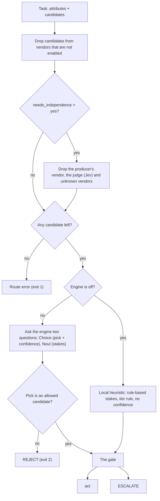
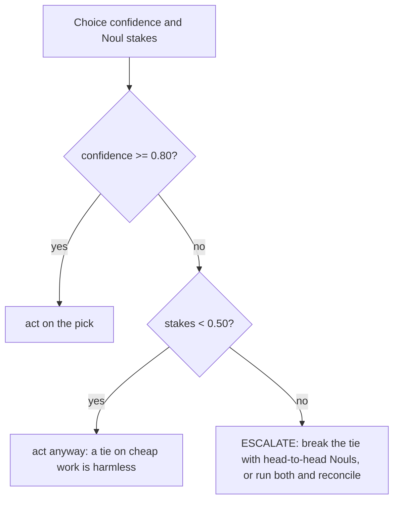

# How it works

> `fo.py` on this page is short for `python3 -I <skill folder>/scripts/fo.py`. See
> the top of [install.md](install.md) for the skill folder.

This page explains how `fo.py route` picks a model for each task. The code is in
[`fo_route.py`](../skills/frontier-orchestration/scripts/fo_route.py).

## The parts

- **A task spec** (`tasks.json`). It describes each task with fixed attributes, not with free
  prose.
- **A decision engine** ("Jev"). It is a System One model: it returns typed answers and
  probabilities, not text. You choose TypeSafe Jev, OpenJev, OpenJev on Codiv, any compatible
  server, or `off` (local rules). See [install.md](install.md#4-choose-a-decision-engine).
- **The roster** ([`data/roster.json`](../skills/frontier-orchestration/data/roster.json)). It
  gives each model id a vendor, a tier (`top`, `frontier`, `mid`, `small`, `judge`), aliases and
  a description.
- **The gate.** It turns the engine's two numbers into one decision: `act`, `ESCALATE` or
  `REJECT`.

## The task spec

```json
{
  "purpose": "one line on what the pipeline produces and who acts on it",
  "policy":  "Prefer the cheapest model that does the job reliably.",
  "tasks": {
    "<task_id>": {
      "what": "what this task does",
      "context_volume": "low | medium | high | very high",
      "output_kind": "prose | code | structured findings | pass/fail",
      "needs_independence": "no | YES - must fail differently from the producer",
      "verifiable_by_code": "no | partly | FULLY",
      "cost_sensitivity": "low | medium | high",
      "producer_vendor": "claude | codex | gemini (who made the artefact)",
      "needs_long_context": "no | yes",
      "candidates": ["model-id or alias", "..."]
    }
  }
}
```

If a task has no `candidates`, every roster model is a candidate. If the spec has no `policy`,
the router uses "Prefer the cheapest model that does the job reliably."

Check a spec with no network: `fo.py route --check tasks.json`.

## The routing flow



Step by step:

1. **Filter.** The router drops candidates from vendors that are not enabled. If the task needs
   independence, it also drops the producer's vendor, the judge and any model of unknown vendor.
   This fails closed: a model whose vendor it cannot check is never kept. If
   `needs_independence` is yes but `producer_vendor` is missing, the route stops with an error.
2. **Ask.** The engine gets the purpose, the policy, a description of each allowed model and
   the task attributes. It answers two questions for each task:
   - a **Choice**: which model should do the task. It returns a pick and a confidence.
   - a **Noul** (a yes/no probability): would a mistake be expensive or hard to detect? It
     returns the stakes probability.
3. **Check.** The pick must be one of the allowed candidates. Any other pick is a `REJECT`.
   A judge number that is not a probability in [0, 1] stops the route.
4. **Gate.** See below.

## The gate: confidence x stakes



| | stakes < 0.50 | stakes >= 0.50 |
|---|---|---|
| **confidence >= 0.80** | act | act |
| **confidence < 0.80** | act | **ESCALATE** |

Why two numbers? Choice confidence measures how concentrated the answer is. It does not measure
whether the answer is right. A near-tie between two good models says that the choice barely
matters. It matters only when a mistake is costly. So the gate escalates only a near-tie on a
high-stakes task. The measured runs behind this rule are in
[`references/evidence.md`](../skills/frontier-orchestration/references/evidence.md).

## Worked example

These four routes are from the skill's own examples
([SKILL.md, section 5](../skills/frontier-orchestration/SKILL.md)):

| Task | Confidence | Stakes | First check | Second check | Decision |
|---|---|---|---|---|---|
| `artifact_build` | 1.00 | 0.15 | 1.00 >= 0.80 | not needed | act |
| `repo_sweep` | 0.87 | 0.57 | 0.87 >= 0.80 | not needed | act |
| `arithmetic_audit` | 0.42 | 0.15 | 0.42 < 0.80 | 0.15 < 0.50 | act: a tie on cheap, checkable work |
| `estimate_review` | 0.48 | 0.89 | 0.48 < 0.80 | 0.89 >= 0.50 | **ESCALATE** |

One decision in four needed more thought, and it was the one that mattered.

## With the engine off

With `jev.backend = off`, the router uses local rules. There is no network and no key.

- **Stakes** start at 0.50. Independence adds 0.25. `verifiable_by_code: FULLY` subtracts 0.30,
  and `no` adds 0.15. `cost_sensitivity` with "high" subtracts 0.10. Prose or critique output
  adds 0.10.
- **Pick.** When stakes are 0.50 or more, it picks the highest tier. When stakes are lower, it
  picks the cheapest tier that is not the judge.
- **Gate.** There is no confidence, so only the stakes check runs. When stakes are high but one
  model is alone in the highest tier, it acts.

The independence rule still applies. You can see this mode with no setup:

```bash
FO_JEV_BACKEND=off python3 -I skills/frontier-orchestration/scripts/fo.py route --demo
```

```
task              model               conf  stakes  decision
--------------------------------------------------------------
repo_sweep        sonnet               -      0.40  act
estimate_review   gpt-6-astra          -      0.85  ESCALATE
arithmetic_audit  haiku                -      0.10  act
```

`estimate_review` escalates because four frontier models tie and the stakes are high.

## After the route

- `act`: use the model. A Claude alias goes to the Agent tool in Claude Code. Other vendors go
  through `fo.py ask` (see [providers.md](providers.md)).
- `ESCALATE`: ask head-to-head Nouls over the same candidates, or run both and reconcile.
- `REJECT`: stop. `fo.py route` exits 2.

`fo.py route tasks.json --json` prints the decisions as JSON for code.

Next: [cost.md](cost.md).
